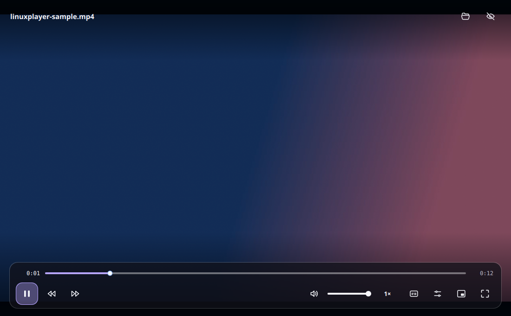

# LinuxPlayer

A clean, modern video player for Linux.

## Install

On Ubuntu or another Debian-based Linux system (64-bit), run:

```bash
curl -fsSLo /tmp/linuxplayer-install.sh \
  https://github.com/huzaifaasim017/linuxplayer/releases/latest/download/install.sh
bash /tmp/linuxplayer-install.sh
```

The [installer](scripts/install.sh) checks which release package fits your system, verifies its checksum, and installs it with `apt`. Open **LinuxPlayer** from the app menu or run `linuxplayer`. To remove it, run `sudo apt remove linuxplayer`.

Prefer a manual install? Download a `.deb` from the [latest release](https://github.com/huzaifaasim017/linuxplayer/releases/latest), then run `sudo apt install ./filename.deb` in the download folder. See [compatibility and source builds](docs/BUILDING.md) if your system's packages differ.

## Use



Open a video with **Open video**, drag a file into the window, or open it from your file manager. The player has seeking, speed, audio and subtitle tracks, resume, fullscreen, and a compact mini-player. Press **Space** to play or pause, **H** to hide or show controls, **I** for the mini-player, and **C** for subtitles. Number keys jump through the video. A finished video plays again from the start when you press Play.

## For developers

[Build from source](docs/BUILDING.md) · [Contribute](CONTRIBUTING.md) · [Architecture](docs/ARCHITECTURE.md) · [Interface guide](docs/INTERFACE.md)

LinuxPlayer is open source under [GPL-3.0-or-later](LICENSE). Its playback engine is the system's libmpv; [third-party license details](docs/LICENSING.md).
