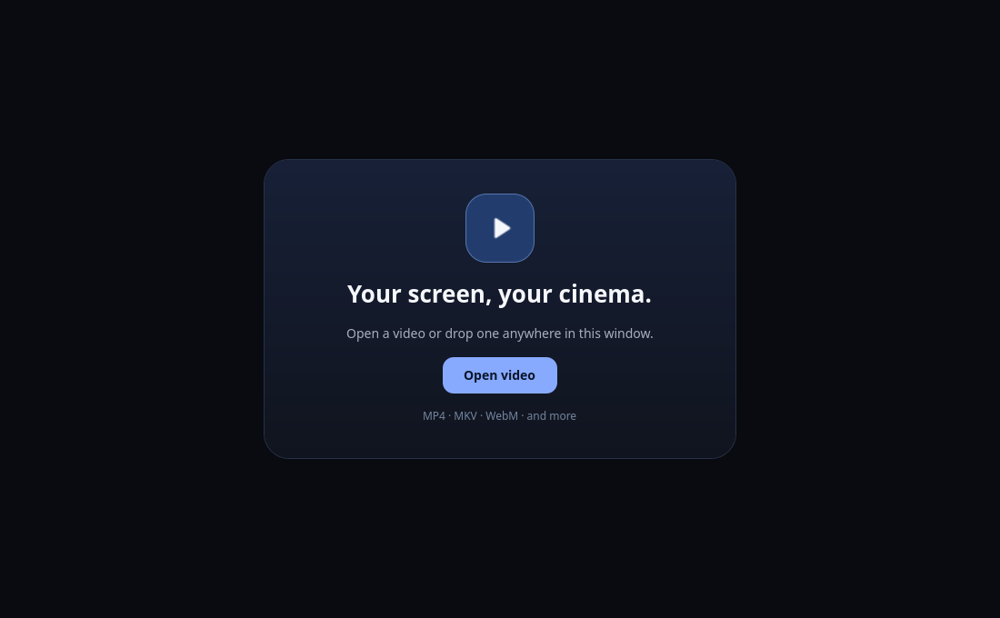
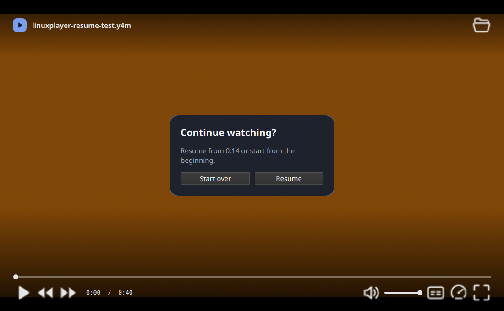

# LinuxPlayer

A modern, focused video player for Linux desktops. LinuxPlayer plays **local files** with a Qt Quick interface and the system's libmpv playback engine. The first target is Ubuntu and other Debian based systems; GNOME is the primary desktop, while the app uses cross-desktop Qt and freedesktop integration.






> **MVP status:** This repository is an early open source release. Check [PRODUCT.md](PRODUCT.md) for the intended first-release scope; release claims should only be made after the checks in [RELEASING.md](docs/RELEASING.md) pass.

## What the current app does

- Open a local video from the app, command line, or drag and drop.
- Play or pause, seek, skip, change volume and speed, and use fullscreen.
- Choose audio and subtitle tracks and load an external subtitle file.
- Show a compact overlay that clears the video while watching.

Useful keys: **Ctrl+O** opens a file; **Space/K** pauses; **Left/Right** skip 5 seconds; **J/L** skip 10 seconds; **Up/Down** adjust volume; **M** mutes; **F** toggles fullscreen; **Esc** leaves fullscreen. The app remembers playback position for local files and offers a Resume or Start over choice. A media library is outside this MVP.

## Build on Ubuntu or Debian

Install the build tools and development libraries:

```bash
sudo apt update
sudo apt install build-essential cmake pkg-config qt6-base-dev qt6-declarative-dev libmpv-dev libgl1-mesa-dev libqt6svg6
```

Configure and build:

```bash
cmake -S . -B build -DCMAKE_BUILD_TYPE=Release
cmake --build build --parallel
ctest --test-dir build --output-on-failure
./build/linuxplayer
```

You can pass a local video path as the first argument:

```bash
./build/linuxplayer /path/to/video.mp4
```

LinuxPlayer uses distro-provided Qt and mpv libraries. Playback formats and hardware acceleration depend on how your distribution builds mpv/FFmpeg and on your graphics drivers.

## Install or make a `.deb`

For a local CMake install:

```bash
sudo cmake --install build --prefix /usr
```

For a Debian package:

```bash
cd build
cpack -G DEB
sudo apt install ./linuxplayer_*.deb
```

Use `sudo apt remove linuxplayer` to uninstall a `.deb`. Prefer the package route if you want clean uninstall tracking. CPack reads the CMake install rules and discovers shared library dependencies with `dpkg-shlibdeps`. The package is built for the machine where you run these commands; do not assume a package built on one Ubuntu release will work on older releases.

## Development

- [Product scope](PRODUCT.md)
- [Architecture](docs/ARCHITECTURE.md)
- [Contributing](CONTRIBUTING.md)
- [Release checks](docs/RELEASING.md)

Bug reports and small improvements are welcome. Include your distribution version, desktop, display session (Wayland or X11), and a way to reproduce playback issues. Avoid uploading copyrighted video; a short freely shareable sample or MediaInfo details is usually enough.

## License

LinuxPlayer's own code and artwork are **GPL-3.0-or-later**; see [LICENSE](LICENSE). It dynamically uses system Qt and libmpv libraries. Those libraries retain their own licenses; see [third-party licensing](docs/LICENSING.md).
