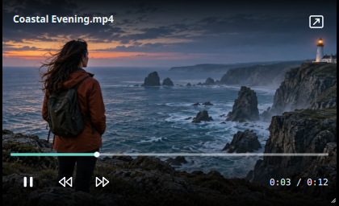

# Interface behavior

LinuxPlayer normally keeps the video as the full window canvas. The floating header identifies the file, while the bottom dock contains the timeline and main controls. Secondary actions live in compact popups so the video stays clear.

## Control visibility

- Starting playback hides the header and dock immediately with a short fade. Moving the pointer reveals them; they fade again after a short idle period while the video is playing.
- The lock button in the header, or **H**, enters a manual hidden mode with no persistent on-screen controls. Pointer movement briefly reveals an unlock button in the top corner. Clicking it or pressing **H** restores the controls. During normal playback the unlock button does not appear when the controls fade.
- Pausing keeps controls available. Opening a menu or dragging the timeline prevents the automatic fade.
- Double-clicking the video toggles fullscreen. A single click plays or pauses after a brief delay so the double-click does not accidentally pause playback.
- Play/pause and fullscreen show a brief center icon. Five/ten-second skips animate near the appropriate side of the video. Timeline seeking shows the destination time, while volume changes show a compact level indicator. Repeating an action restarts its feedback animation.

## Playback actions

The dock has play/pause, ten-second skip buttons, elapsed and duration times, volume, speed, audio/subtitle tracks, more options, mini-player, and fullscreen. Click the duration to switch between total and remaining time. The more menu provides loop, fit/fill, canvas ratios, default-player setup, screenshot, external subtitles, and shortcut help. **F1** opens the shortcut list. The lock button is separate from fullscreen.

The shortcut list opens above the bottom controls like the other menus and scrolls in a short window. **Use system accent** in More options applies the desktop accent to interactive highlights; it is optional and persists between launches.

## Canvas preview and file associations

**More options → Canvas ratio** opens a scrollable preset list with original window size, 16:9, 9:16, 1:1, 4:5, 3:4, 2:1, 1:2, and 1.91:1. Width and height fields allow any positive custom ratio. The preview canvas is centered and maximized inside the available window; the rest of the window stays dark. **Fit video** letterboxes the source inside it; **Fill video canvas** crops the playback view. Neither setting changes the media file, screenshots from libmpv, or an exported file. Preset names are examples of common platform layouts, not an upload-compliance guarantee.

The examples are grounded in [YouTube's standard 16:9 player](https://support.google.com/youtube/answer/6375112), [Meta's 9:16 Reels guidance](https://www.facebook.com/business/ads/facebook-instagram-reels-ads), and [Etsy's 2:1 or 1:2 listing-video guidance](https://help.etsy.com/hc/en-in/articles/360053206073-How-to-Add-a-Listing-Video). Platform requirements can change; use their current upload guidance before publishing.

**Make default video player** runs only on a user click. It uses `xdg-mime` to set and verify the video MIME types listed in the installed desktop entry, then reports success or failure. The option requires an installed package and `xdg-utils`; a source-tree run cannot set an uninstalled desktop entry as default. Desktop environments may also expose their own default-app settings.

## Mini-player

Click the picture-in-picture icon or press **I** to turn the current window into a compact, frameless player. Playback continues in the same `MpvItem`; there is no second decoder or handoff. It offers a slim seek bar, play/pause, skips, time, and a restore button. Press **I** or **Escape** to restore the previous size and window state. Drag its top area to move it and its bottom-right corner to resize it.

The app requests an always-on-top window, but Qt leaves that decision to the desktop's window manager or Wayland compositor. Do not promise that it will float over every app on every desktop. Keep restore and playback usable even if the compositor ignores the hint.

At the end of a video, the primary control becomes Play and starts the video again from the beginning. The controls remain visible at the end. A centered loading spinner appears only after a short delay while a file opens or playback buffers; quick opens do not flash a loading state.

The **C** shortcut switches the selected subtitle track on or off. Number keys **0–9** seek to 0–90% of the video, matching a familiar web-player interaction.

Keyboard shortcuts are listed in the app's help popup and in the README. Every icon-only button needs an accessible name and a tooltip. Every new menu action should expose its current state when relevant and show an error or confirmation where the action is not obvious.

## Icons and styling

Icons in `qml/icons/` are small SVG sources with a 24 × 24 view box. `IconButton.qml` renders them at the display's physical pixel density inside a fixed logical-size item; letting Qt Controls stretch the image item makes them blurry. Keep shapes legible at 18–22 logical pixels and use the same stroke, corner, and spacing style when adding icons.

The dock and menus use translucent dark surfaces with a visible border. Check contrast against both bright and dark video frames, at normal, narrow, and mini-player widths. Do not place permanent sidebars over the video.
