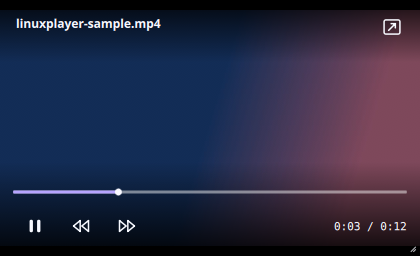

# Interface behavior

LinuxPlayer keeps the video as the full window canvas. The floating header identifies the file, while the bottom dock contains the timeline and main controls. Secondary actions live in compact popups so the video stays clear.

## Control visibility

- Moving the pointer reveals the header and dock during playback. They fade after a short idle period while the video is playing.
- The eye button in the header, or **H**, enters a manual hidden mode. Pointer movement reveals only an eye icon in the top corner. Clicking it or pressing **H** restores the controls; the icon then fades away again.
- Pausing keeps controls available. Opening a menu or dragging the timeline prevents the automatic fade.
- Double-clicking the video toggles fullscreen. A single click plays or pauses after a brief delay so the double-click does not accidentally pause playback.

## Playback actions

The dock has play/pause, ten-second skip buttons, elapsed and duration times, volume, speed, audio/subtitle tracks, more options, mini-player, and fullscreen. Click the duration to switch between total and remaining time. The more menu provides loop, fit/fill, screenshot, external subtitles, and shortcut help. The eye button is intentionally separate from fullscreen.

## Mini-player

Click the picture-in-picture icon or press **I** to turn the current window into a compact, frameless player. Playback continues in the same `MpvItem`; there is no second decoder or handoff. It offers a slim seek bar, play/pause, skips, time, and a restore button. Press **I** or **Escape** to restore the previous size and window state. Drag its top area to move it and its bottom-right corner to resize it.

The app requests an always-on-top window, but Qt leaves that decision to the desktop's window manager or Wayland compositor. Do not promise that it will float over every app on every desktop. Keep restore and playback usable even if the compositor ignores the hint.

At the end of a video, the primary control becomes Play and starts the video again from the beginning. The controls remain visible at the end. A centered loading spinner appears only after a short delay while a file opens or playback buffers; quick opens do not flash a loading state.

The **C** shortcut switches the selected subtitle track on or off. Number keys **0–9** seek to 0–90% of the video, matching a familiar web-player interaction.

Keyboard shortcuts are listed in the app's help popup and in the README. Every icon-only button needs an accessible name and a tooltip. Every new menu action should expose its current state when relevant and show an error or confirmation where the action is not obvious.

## Icons and styling

Icons in `qml/icons/` are small SVG sources with a 24 × 24 view box. `IconButton.qml` renders them at the display's physical pixel density inside a fixed logical-size item; letting Qt Controls stretch the image item makes them blurry. Keep shapes legible at 18–22 logical pixels and use the same stroke, corner, and spacing style when adding icons.

The dock and menus use translucent dark surfaces with a visible border. Check contrast against both bright and dark video frames, at normal, narrow, and mini-player widths. Do not place permanent sidebars over the video.
